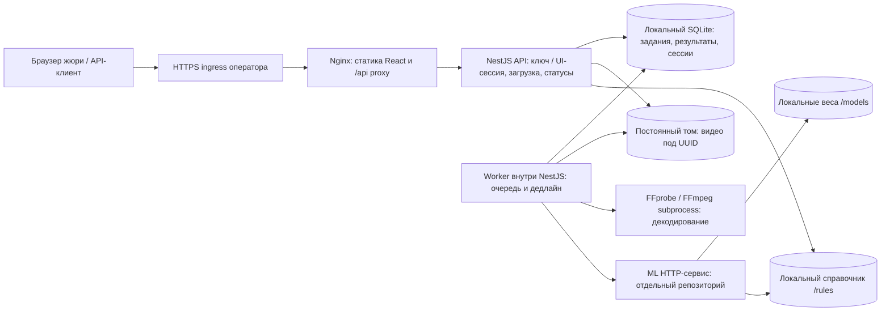

# Архитектура и локальность: фактическое состояние

Аудит выполнен на ветке `main`. Это описание реализации, а не обещание 10 баллов.
ML-репозиторий, веса, утверждённый нормативный справочник и GPU не были доступны.

## Приоритеты аудита

| Приоритет | Найдено до изменений | Состояние |
| --- | --- | --- |
| P0 | Задания/сессии только в памяти; потеря после рестарта | Исправлено: SQLite на постоянном томе, незавершённые задания → failed без повторного анализа |
| P0 | Таймаут только HTTP-вызова, очередь без общего дедлайна | Исправлено: единый бюджет ≤300 секунд, ограничение приёма и worker |
| P0 | Frontend вызывает защищённые машинные маршруты без ключа, ожидает result/events вместо verdict/violations | Не исправлено: действует ранее заданный запрет редактирования frontend; запрос на разрешение отправлен. См. frontend-handoff.md |
| P1 | MIME выдавался за проверку видео | Исправлено: ffprobe + полное декодирование видеопотока FFmpeg в worker |
| P1 | Нет сетевой изоляции/воспроизводимого запуска | Добавлены Dockerfile, Compose, внутренняя сеть и процедура offline-проверки; контейнерный запуск не выполнен |
| P1 | Нет справочника и проверки верхней границы таймкодов | Добавлена обязательная локальная таблица rule_id и проверка по длительности; реальный справочник должен предоставить участник |
| P1 | Формат кадров/доказательств не согласован | Не выдуман: публичный контракт не содержит кадров; непустые frames из ML отклоняются |
| P2 | Нет health/readiness, сроков очистки и проверки рестарта | Исправлено и покрыто тестами, с оговорками ниже |

## Схема

HTTPS ingress — внешняя обязанность оператора; его реализации здесь нет. Compose публикует HTTP Nginx на loopback:8080 для подключения ingress. NestJS и ML не публикуют порты и подключены только к `internal: true` сети. Nginx находится в обеих сетях и проксирует только в фиксированный backend. **Существующий React-клиент ещё требует интеграционных исправлений**, поэтому диаграмма показывает доступные компоненты, а не подтверждённый браузерный E2E.

## Путь видео и ответственность

1. API проверяет `X-API-Key` на обоих машинных маршрутах или отдельную HttpOnly-сессию на `/api/v1/ui/*`. UI-сессия не содержит ключ жюри. Origin защищает изменяющие запросы UI.
2. До чтения multipart резервируется место. Проверяются MIME, размер и единственное поле `file`. Поток пишется на локальный диск под UUID; исходное имя не используется как путь. Незавершённая загрузка ограничена 60 секундами.
3. После завершения загрузки API фиксирует `processing` в SQLite и отдаёт `202 {job_id}`. Он не ждёт FFmpeg или ML.
4. Worker — отдельный Nest provider, **не отдельный контейнер/процесс**. Каждые 50 мс он читает индексированную очередь из SQLite. Число активных задач ограничено `ML_CONCURRENCY` (по умолчанию 1).
5. FFprobe читает метаданные; FFmpeg полностью декодирует первый видеопоток в null output. Shell не используется; разрешены только локальные протоколы и MOV/MP4/WebM-демультиплексоры. Повреждение или превышение настроенной длительности приводит к `failed/INVALID_VIDEO`, ML не вызывается. Аудио не анализируется этой проверкой.
6. Backend передаёт файл внутреннему `ML_SERVICE_URL` один раз, с `X-Job-Id` и `X-Deadline-At`. ML отвечает за модель, анализ, события и доказательства. Автоматических повторов и облачного fallback нет.
7. Адаптер проверяет JSON, verdict, набор нарушений, существование `code` как rule_id, конечные неотрицательные таймкоды в пределах длительности. Внутренний `no_violation` допускается только с пустым violations и преобразуется в публичный `pass`. Ошибка никогда не становится `pass`.
8. Результат сохраняется в SQLite до выдачи `done`. Опрос читает устойчивое состояние. Код/описание нарушения возвращаются как данные, не HTML.

Схема результата `pass/fail`, `violations[{code,message,timestamp_seconds}]` сохранена. Добавлены только необходимые коды ошибок. Текущий API **не доставляет кадры и документы доказательств**. Непустое поле ML `frames` отклоняется: backend не принимает внешние URL за проверенные доказательства. Расширение требует согласованной схемы, локального хранения и авторизации выдачи кадров.

## Почему такая архитектура

Существующий стек NestJS/React сохранён. SQLite решает конкретную проблему потери состояния без Redis/PostgreSQL и дополнительных сетевых зависимостей. WAL и synchronous=FULL обеспечивают транзакционную фиксацию при обычном завершении/сбое процесса. Это не защита от утраты диска или ошибки файловой системы: нужен постоянный том и резервирование у оператора.

Декодирование вынесено в дочерний процесс, ML — асинхронный HTTP; тяжёлая работа не выполняется синхронно в обработчике API. Небольшие SQLite-запросы синхронны и могут кратко задерживать event loop на медленном диске. Это осознанное ограничение однопроцессной версии, а не заявление о нулевой блокировке.

Worker, хранилище, валидация видео и ML-адаптер разделены по модулям. Модель можно заменить за внутренним HTTP-адаптером без изменения публичного API, если новая модель выдаёт тот же проверяемый результат. Разделять каждый модуль на микросервис сейчас не требуется.

## Дедлайн и перегрузка

`JOB_DEADLINE_MS` не может превышать 300000. Отсчёт начинается при резервировании запроса backend, включая дальнейшую загрузку и очередь. Время передачи до попадания запроса в backend не измеряется. Nginx отключает буферизацию тела запроса.

Настройки по умолчанию: проверка медиа ≤30 с, ML ≤180 с, запас 5 с, одна активная/ожидающая задача. Приём также проверяет консервативный бюджет `ceil((pending+1)/concurrency) × (mediaTimeout+mlTimeout+margin) < deadline`; перегрузка даёт 503 до загрузки. Для следующего ML-вызова таймаут уменьшается до оставшегося бюджета. Очередь и выполняющиеся задачи завершаются `failed` при дедлайне, запоздалый успех не переписывает failure.

Это ограничивает время до конечного статуса при работающем backend; **не гарантирует успешный анализ любой записи за 5 минут**. Реальная модель, кодек, длительность, GPU и нагрузка должны быть измерены. При падении сервера опрос недоступен до рестарта. Предел длительности 3600 с и 100 MiB — изменяемые эксплуатационные настройки, не приписанные хакатону требования.

## Сбои, завершение и хранение

- Неверный ключ: 401 до чтения файла. Перегрузка: 503. Неверный MIME: 415, размер: 413.
- Недоступный ML/таймаут: `failed/ML_UNAVAILABLE`. Неверный JSON/правило/таймкод/несогласованные frames: `failed/ML_INVALID_RESPONSE`.
- Общий дедлайн: `failed/DEADLINE_EXCEEDED`. Повторного ML-запроса нет.
- При старте любое оставшееся `processing` становится `failed/PROCESS_INTERRUPTED`. Нельзя считать неизвестный результат успешным или безопасно повторить дорогое вычисление.
- SIGTERM: worker прекращает работу, отменяет HTTP/декодирование, фиксирует failure, закрывает SQLite. Docker использует init и grace period. При SIGKILL восстановление происходит на следующем старте.
- Видео удаляются по `VIDEO_RETENTION_MS`, включая осиротевшие загрузки; период уборки `CLEANUP_INTERVAL_MS`. Активные файлы защищены. Фактический минимум хранения orphan-файла — `UPLOAD_TIMEOUT_MS+1000`, чтобы не удалить живую загрузку. Отсчёт от mtime; превышение TTL возможно на период уборки и во время работы/остановки сервера.
- Результаты живут `JOB_TTL_MS` после завершения, сессии — `SESSION_TTL_MS` после входа. Сессии сохраняются в SQLite в виде хешей случайных токенов. При смене UI-кода старые сессии действуют до expiry/выхода; для немедленного отзыва оператор должен удалить записи sessions при остановленном backend.
- В случае ошибки записи worker выключает readiness. Восстановление требует исправления диска/перезапуска; нельзя обещать фиксацию статуса при неработающем хранилище.

**Ограничение отмены:** AbortSignal закрывает HTTP-запрос backend, но не доказывает остановку GPU-задачи в другом репозитории. Лимит backend ограничивает его запросы, а не оставшиеся после отмены вычисления ML. ML обязан реализовать дедлайн, остановку/уборку ресурсов при отключении клиента и ограниченную собственную очередь; иначе после таймаута новые задания могут пересекаться со старыми. Не повторять неизвестный анализ вручную, пока ML не подтвердит остановку.

## Локальность

В исходниках backend нет облачных AI SDK, удалённых хранилищ или загрузки моделей. Единственные HTTP-вызовы — конфигурируемые ML inference и health. URL ограничены явным списком внутренних имён, редиректы запрещены. Allowlist сам по себе не защищает от неверного DNS: сетевой запрет egress обеспечивается Compose и должен проверяться на машине развёртывания.

Во время установки нужны npm/apt/образы; веса загружаются отдельно до начала эксплуатации. Runtime запускает готовый Node-код, читает локальные видео/SQLite/справочник. ML получает read-only `/models` и `/rules/rules.json`, offline-переменные Hugging Face и отключение telemetry. Это требования к ML-образу, а не доказательство, что он им следует.

Просмотрен прикладной код и manifests; cloud AI/telemetry не обнаружены. Полный аудит всех транзитивных пакетов и ML-репозитория не выполнен. В frontend/index.html найдены внешние Google Fonts; справочные Reference-файлы содержат внешние изображения/CDN, но не входят в приложение. Nginx CSP запрещает внешние ресурсы и запросы в поставляемом deployment, поэтому шрифты/иконки до исправления frontend могут отображаться некорректно. CSP не заменяет исправление клиента и проверку Network в браузере.

Публичный входящий HTTPS для жюри не противоречит запрету исходящего интернета для обработки. Видео отправляется только внутрь решения. Облачные инструменты не получали пользовательских видео/кадров/описаний; тесты используют программно созданный цветной кадр.

## Развитие и границы

- Сейчас **ровно один backend на одном SQLite-томе**. Не запускать несколько реплик с этим хранилищем: восстановление считает все processing прерванными; распределённых lease нет.
- Увеличивать `ML_CONCURRENCY` можно только после измерения реальной ёмкости ML. Admission-budget продолжает ограничивать очередь.
- Для нескольких worker-процессов нужно атомарное получение задания с lease/heartbeat, fencing и общая БД (например PostgreSQL), плюс локальное общее файловое хранилище. Это план расширения, а не реализованный компонент.
- Нет подтверждённых GPU-настроек, throughput и качества модели. GPU Compose override должен дать ML-разработчик под свой образ и хост; фиктивные CUDA-команды не добавлены.
- Реальный нормативный справочник отсутствует. Пример содержит только синтетические правила и запрещён в production.
- `node:sqlite` используется из Node 24; API этой ветки имеет experimental-статус. Версия Node закреплена для Docker; обновление требует прогнать тесты.

## Требование → реализация → доказательство

| Требование | Реализация | Доказательство / статус |
| --- | --- | --- |
| Быстрый job_id, API не ждёт ML | Контроллер фиксирует запись; worker опрашивает очередь | HTTP-тест удерживает ответ тестового ML и получает 202/processing |
| Устойчивое хранение | SQLite WAL/FULL на DATA_DIR | Отдельный процесс принудительно завершён, второй читает done и UI-сессию |
| Нет вечного processing после рестарта | PROCESS_INTERRUPTED на старте | Тест SIGKILL, отсутствие повторного ML-вызова |
| Лимит очереди/параллельности | Admission + worker semaphore | Тест переполнения 503 и восстановления ёмкости |
| Дедлайн с очередью | Абсолютный deadline в SQLite, watchdog | Тест истечения ожидающей задачи; реальный SLA модели не измерен |
| MOV ~29 MiB | Поток на диск, FFprobe + FFmpeg | Программно созданный rawvideo MOV 29–30 MiB, upload → done |
| Повреждение/длительность | Полное декодирование, конфигурация | Corrupt-video и duration tests, ML не вызывается |
| Нет ложного no_violation | Только проверенный пустой список → pass | HTTP-тест no_violation; ошибки → failed |
| Правила/таймкоды | Локальный каталог + границы длительности | Неизвестный code/таймкод/frames отклонены |
| Авторизация | X-API-Key и отдельные cookie-сессии | HTTP-тесты неверного ключа, Origin, изоляции и logout |
| Очистка | TTL-файлов и состояний | Тест удаления старого orphan и expiry |
| Health/readiness | БД, worker, FFmpeg, ML health | HTTP-тесты health на локальном тестовом ML |
| Воспроизводимое развёртывание | Dockerfile + npm ci + Compose | Compose config и синтаксис offline-скрипта проверены; build/up не выполнены |
| Без исходящего интернета | internal network, локальные bind mounts | **Проверка подготовлена, но не выполнена**: deploy/check-offline.mjs |
| Результат реальной модели ≤5 минут | Бюджеты и admission; требуется измерение | **Не подтверждено**: нет реального ML/оборудования |
| Полноценный браузерный путь | Требует frontend-адаптера и login | **Не подтверждено**, исправления переданы в frontend-handoff.md |

Тестовая процедура: `cd backend && npm test`, с установленными FFmpeg/FFprobe или явными путями к ним. Время тестового сервера не является временем модели.

Основания технических решений: [Node SQLite](https://nodejs.org/docs/latest-v24.x/api/sqlite.html), [Compose internal networks](https://docs.docker.com/reference/compose-file/networks/#internal), [FFmpeg](https://ffmpeg.org/ffmpeg.html). Эти источники описывают механизмы, а не подтверждают свойства нашего deployment.
